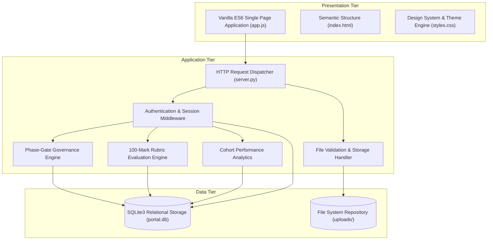
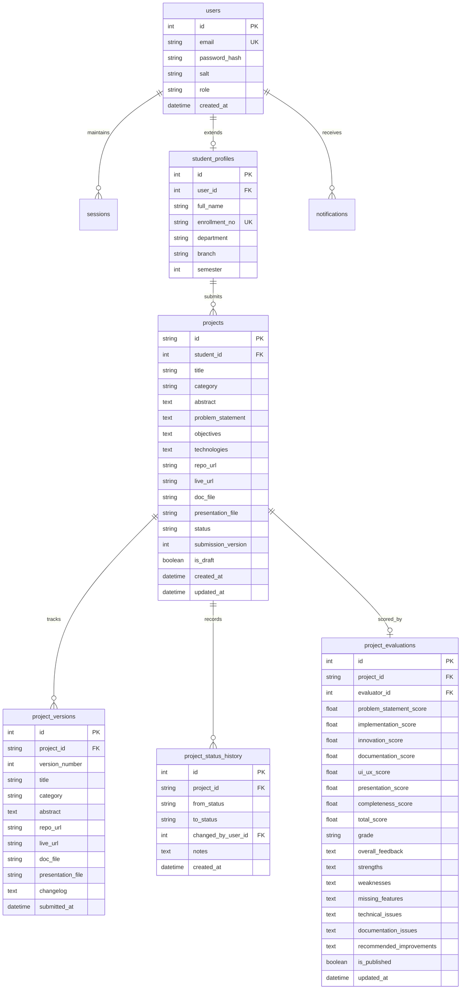
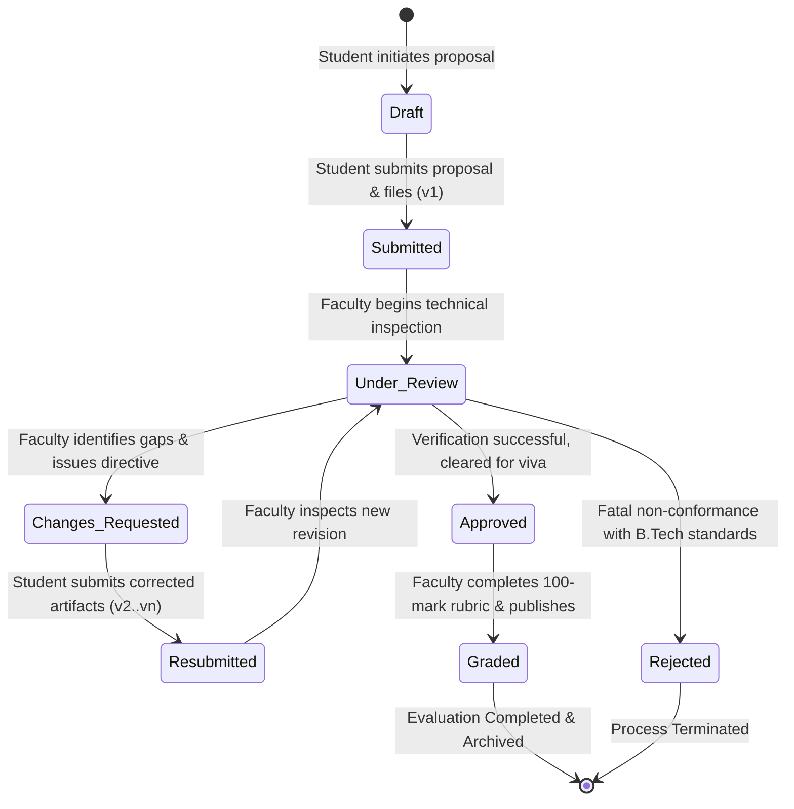

# SYSTEM ARCHITECTURE & DESIGN SPECIFICATION

## EduProject: Student Project Management & Evaluation Platform

---

### 1. Architectural Overview & Design Patterns
EduProject is designed following a **Three-Tier Architecture** with a decoupled Single Page Application (SPA) frontend, a lightweight stateless REST application tier, and an ACID-compliant relational persistence layer.

---

### 2. Detailed Component Decomposition

#### 2.1 Presentation Tier
- **State Store:** Managed within the `APTSClient` class (`app.js`). Stores active user profile, session token, project caches, and selected view state.
- **Theme Engine:** CSS custom properties define colors, spacing, typography, and dark navy glowing background grids.
- **Charts Engine:** Pure inline SVG rendering without external chart libraries (e.g. Chart.js, D3). Ensures zero bundle latency and exact color system alignment.

#### 2.2 Application Tier (REST API)
- Built on Python 3's `http.server.BaseHTTPRequestHandler`.
- Custom JSON serialization and error handling helper methods (`send_json`, `send_error_json`).
- PBKDF2 with SHA-256 password hashing (100,000 iterations + 16-byte cryptographically secure salt).
- Role-Based Access Control (RBAC) enforced on every private route.

#### 2.3 Data Persistence Tier
- **Foreign Key Cascades:** `PRAGMA foreign_keys = ON;`
- **Write-Ahead Logging (WAL Mode):** Ensures high read throughput while maintaining write serialization without locking conflicts.
- **Transactional Consistency:** All multi-table updates (e.g., project resubmission creating a new version and logging status history) execute within explicit SQLite database transactions.

---

### 3. Entity-Relationship (ER) Diagram

---

### 4. Process Workflow & State Lifecycle

---

### 5. Multi-Version Revision Provenance Architecture
To solve the industry problem of duplicate project rows, EduProject separates the master entity identity from version artifacts:
- **Canonical Master Record (`projects`):** Holds the project's unique ID (`PRJ-2026-XXX`), current lifecycle status, and active pointer to the latest submission version.
- **Immutable Revision Ledger (`project_versions`):** Appends a new immutable snapshot row every time the student resubmits. Includes uploaded files, updated URLs, and explicit changelog text explaining how faculty comments were resolved.
